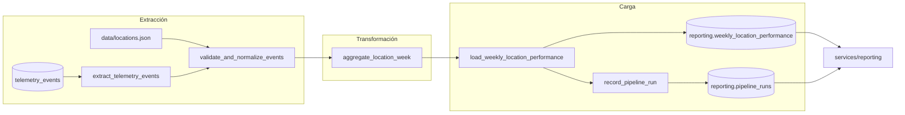

# Pipeline de Desempeño de Negocio — Documento de diseño (v1)

> **Alcance:** solo diseño. No hay código de orquestación en esta fase; la implementación llega en las Partes 2 y 3.
> **Empresa:** Brasaland (14 locales, `L01`–`L14`, países `CO` y `US`).

## Índice

1. [Estado actual](#1-estado-actual)
2. [Brecha de negocio](#2-brecha-de-negocio)
3. [Propósito del pipeline](#3-propósito-del-pipeline)
4. [Formato de extracción](#4-formato-de-extracción)
5. [Flujo de datos](#5-flujo-de-datos)
6. [Actualización de registros existentes](#6-actualización-de-registros-existentes)
7. [Destino: tablas y endpoints](#7-destino-tablas-y-endpoints)
8. [Resiliencia e idempotencia](#8-resiliencia-e-idempotencia)
9. [Mapeo a Prefect](#9-mapeo-a-prefect)
10. [Integración con la aplicación](#10-integración-con-la-aplicación)
11. [Preguntas de diseño](#11-preguntas-de-diseño)
12. [Restricciones y decisiones abiertas](#12-restricciones-y-decisiones-abiertas)

---

## 1. Estado actual

### Qué se captura

- **Contrato:** `docs/telemetry/event-schemas.json`, JSON Schema Draft 2020-12 versión 1.0.0. El plan está en `docs/telemetry/telemetry-plan.md` (22 eventos, seis obligatorios).
- **Origen de los eventos:** el backend devuelve los eventos confirmados en el campo `telemetry_events` de sus respuestas (autenticación, inventario). El cliente `uis/backoffice/app/telemetry.ts` los encola y los envía.
- **Cliente:** cola en memoria de 200 eventos, lotes de 20 eventos y 64 KiB como máximo, envío cada 10 s, 3 intentos con espera creciente (respeta `Retry-After`) y `sendBeacon` al cerrar la pestaña.
- **Eventos obligatorios que usa este pipeline:** `inbound_order_created`, `stock_waste_registered`, `stock_threshold_triggered` y `ingredient_price_variance_detected`. `outbound_order_created` queda fuera de la v1.

### Dónde se almacena

- **Endpoint de captura:** `POST /telemetry/events` (`services/brasaland_api/routes/telemetry.py`), con límite de 20 eventos y 64 KiB por lote.
- **Tabla:** `telemetry_events` en Supabase/PostgreSQL, modelo `TelemetryEventRecord` (`services/brasaland_api/telemetry_models.py`).

| Columna | Tipo | Nota |
|---|---|---|
| `id` | entero | clave primaria interna |
| `event_id` | texto | único; es la clave de deduplicación |
| `timestamp` | `timestamptz` | momento del evento, con índice |
| `event_type` | texto | con índice |
| `schema_version` | texto | `1.0.0` |
| `request_id` | texto | con índice; une el evento con la petición |
| `session_id`, `user_id` | texto, opcionales | |
| `properties` | JSON/JSONB | payload del evento |
| `received_at` | `timestamptz` | momento de llegada al servidor |

- **Duplicados hoy:** si un `event_id` ya existe, el commit falla, se hace rollback y se registra la excepción. La respuesta (`{"received": n, "persisted": m}`) no distingue "ya almacenado" de "falló al guardar".

### Qué responde hoy el reporte técnico

- **Endpoint:** `GET /telemetry/report`, con caché de 60 s. Lo consume el dashboard de `uis/backoffice/app/telemetry-report`.
- **Lógica:** `services/telemetry/analysis.py` calcula `events_per_day`, `error_rate_by_type`, `api_latency_summary` y `auth_failure_rate`.
- **Pregunta que responde:** volumen de eventos, tasa de errores, latencia y fallos de autenticación, para ingeniería.
- **No verifica datos reales:** este documento describe el código, no el contenido de la base en producción.

## 2. Brecha de negocio

El reporte técnico no responde la pregunta de Mariana y Felipe: **¿cuánto gasta cada local en compras, cuánto pierde en merma y qué tan seguido se queda sin stock?**

| Necesidad | ¿Lo responde el reporte técnico? |
|---|---|
| Costo de compra por local y semana | No. No suma importes ni agrupa por `location_id`. |
| Costo de merma y ratio de merma | No. |
| Quiebres de stock por local | No. |
| Alertas de precio por local | No. |
| Comparar locales en `COP` y `USD` sin mezclar monedas | No. |

Hace falta un pipeline dedicado que lea esos eventos, los agregue por local y semana y deje el resultado en tablas de negocio.

## 3. Propósito del pipeline

> Producir cada lunes el consolidado semanal por local (`location_id`) que alimenta el **Reporte Semanal de Costo y Merma por Local** para Mariana (CEO) y Felipe (Operaciones), calculando costo de compra, costo de merma, ratio de merma, frecuencia de quiebre de stock y frecuencia de alertas de precio a partir de `inbound_order_created`, `stock_waste_registered`, `stock_threshold_triggered` e `ingredient_price_variance_detected`.

### KPIs

| KPI | Campo de salida | Cálculo | Evento fuente |
|---|---|---|---|
| Costo de compra por local | `total_purchase_cost` | suma de `total_amount` | `inbound_order_created` |
| Costo de merma por local | `total_waste_cost` | suma de `total_amount` | `stock_waste_registered` |
| Ratio de merma | `waste_ratio` | `total_waste_cost / total_purchase_cost`; 0 si no hubo compras | ambos |
| Frecuencia de quiebre de stock | `stockout_events_count` | conteo | `stock_threshold_triggered` |
| Frecuencia de alertas de precio | `price_alert_events_count` | conteo | `ingredient_price_variance_detected` |

## 4. Formato de extracción

### Tablas de origen

| Origen | Uso | Acceso |
|---|---|---|
| `telemetry_events` | fuente principal de eventos | solo lectura |
| `data/locations.json` | catálogo de locales: `id`, `code` (`L01`–`L14`), `country`, `currency`, `timezone` | lectura |
| `ingredient_entries` e `ingredient_exits` | reconciliación de volumen (ver pregunta 6) | solo lectura |

### Consulta de extracción

Los eventos de la semana, filtrados por tipo y por el `timestamp` del evento (no por `received_at`):

```sql
select event_id, timestamp, event_type, properties, received_at
from telemetry_events
where event_type in ('inbound_order_created', 'stock_waste_registered',
                     'stock_threshold_triggered', 'ingredient_price_variance_detected')
  and timestamp >= :week_start
  and timestamp <  :week_end;
```

La semana va de lunes 00:00 UTC (incluido) a lunes siguiente 00:00 UTC (excluido).

### Forma del payload

`properties` usa los campos de `inventoryBase` del contrato más los propios de cada evento:

| Campo | Aparece en | Nota |
|---|---|---|
| `location_id` | todos | formato `L01`–`L14`, validado contra el catálogo |
| `country`, `currency` | todos | `CO` implica `COP`; `US` implica `USD` |
| `product_id`, `product_category`, `quantity`, `unit` | todos | `product_id` es el ID de `Ingredient` |
| `order_id` | los cuatro eventos | ID de la entrada o salida confirmada |
| `supplier_id`, `unit_price`, `total_amount` | `inbound_order_created` | importes como texto con dos decimales (`"8420.50"`) |
| `reason` | `stock_waste_registered` | `expired`, `kitchen_error` o `theft_suspected` |
| `stock_before`, `stock_after`, `minimum_stock` | `stock_threshold_triggered` | |
| `reference_price`, `variance_pct`, `threshold_pct` | `ingredient_price_variance_detected` | |

Los importes se leen como decimales exactos, nunca como coma flotante.

### Brecha de esquema: costo de la merma

`stock_waste_registered` incluye ahora el costo de la merma mediante dos campos aditivos. `unit_price` es el promedio ponderado de las compras anteriores del mismo ingrediente en ese local, y `total_amount` es la cantidad mermada multiplicada por ese precio.

| Evento | Campo | Definición |
|---|---|---|
| `stock_waste_registered` | `unit_price` | costo por unidad, mismo formato que en `inbound_order_created` |
| `stock_waste_registered` | `total_amount` | `quantity` por `unit_price`, redondeado a dos decimales |

Los eventos de merma anteriores a la extensión no tienen costo. El pipeline los descarta con el motivo `missing_cost` y los cuenta en el log de la corrida.

### Cadencia

- **Fuente:** se actualiza de forma continua; el cliente envía lotes cada 10 s o al llegar a 20 eventos.
- **Pipeline:** corre una vez por semana, el lunes temprano en UTC, para la semana cerrada. En cada corrida también recalcula la semana anterior (ver pregunta 3).
- **Disparo manual:** `POST /reporting/pipeline-runs`, para cualquier semana.

## 5. Flujo de datos



| Etapa | Tarea | Qué hace |
|---|---|---|
| Extracción | `extract_telemetry_events` | lee los eventos de la semana desde `telemetry_events` |
| Transformación | `validate_and_normalize_events` | descarta eventos inválidos, deduplica por `event_id` y por `(event_type, order_id)`, convierte importes a decimal |
| Transformación | `aggregate_location_week` | agrupa por `location_id`, calcula los cinco KPIs y la moneda por país |
| Carga | `load_weekly_location_performance` | upsert de las 14 filas en una sola transacción |
| Carga | `record_pipeline_run` | escribe el log de la corrida, incluso si falló |

## 6. Actualización de registros existentes

Cada semana se vuelve a calcular y puede existir ya una fila para ese `(location_id, week_start)`. El mecanismo es:

1. **Clave natural:** `unique (location_id, week_start)` en `reporting.weekly_location_performance`.
2. **Upsert:** `insert ... on conflict (location_id, week_start) do update set ... , computed_at = now()`. Todos los campos de métrica se **reemplazan** por el valor recalculado; nunca se suman a lo que ya había.
3. **Timestamp de última modificación:** `computed_at` indica cuándo se calculó por última vez cada fila.
4. **Tabla de control:** `reporting.pipeline_runs` guarda qué corrida escribió cada semana y cuántos eventos leyó.

Como el valor siempre se recalcula completo desde la fuente, repetir la corrida da el mismo resultado y no duplica filas.

## 7. Destino: tablas y endpoints

### Tablas nuevas, esquema `reporting`

**`reporting.weekly_location_performance`** (nombre exacto del BRIEFING):

```sql
create table reporting.weekly_location_performance (
  id uuid primary key default gen_random_uuid(),
  location_id text not null,
  country text not null,
  week_start date not null,
  total_purchase_cost numeric not null default 0,
  total_waste_cost numeric not null default 0,
  waste_ratio numeric not null default 0,
  stockout_events_count integer not null default 0,
  price_alert_events_count integer not null default 0,
  currency text not null,
  computed_at timestamptz not null default now(),
  unique (location_id, week_start)
);
```

**`reporting.pipeline_runs`** (log de ejecución, ver sección 8).

Nada se escribe en `telemetry_events`.

### Endpoints nuevos, módulo `services/reporting/`

Separados de `services/telemetry/` y de `GET /telemetry/report`:

| Endpoint | Función |
|---|---|
| `GET /reporting/weekly-location-performance?week_start=` | consulta de KPIs |
| `GET /reporting/pipeline-runs/latest` | estado de la última corrida |
| `POST /reporting/pipeline-runs` | disparo manual |

Ejemplo de respuesta de la consulta de KPIs:

```json
{
  "week_start": "2026-07-13",
  "locations": [
    {
      "location_id": "L02",
      "country": "CO",
      "total_purchase_cost": 8420000,
      "total_waste_cost": 610000,
      "waste_ratio": 0.072,
      "stockout_events_count": 2,
      "price_alert_events_count": 1,
      "currency": "COP"
    }
  ]
}
```

El BRIEFING usa `medellin-centro` como `location_id` en su ejemplo; este diseño usa `L02` porque el contrato de telemetría exige el formato `L01`–`L14`.

## 8. Resiliencia e idempotencia

### Estrategia de idempotencia

- **Fuente de verdad:** cada corrida calcula la semana completa desde `telemetry_events`; no guarda estado intermedio ni acumula incrementos.
- **Carga atómica:** las 14 filas se escriben en **una sola transacción**. Si falla en mitad de la carga, se hace rollback y la tabla queda como estaba antes, nunca con datos parciales.
- **Segunda corrida tras un fallo en la carga:**
  1. La corrida fallida queda en `pipeline_runs` con `status = 'failed'` y su `error_message`.
  2. La nueva corrida vuelve a extraer y a agregar la misma ventana.
  3. El upsert reemplaza las filas por los valores recalculados.
  4. El resultado es idéntico al de una corrida limpia: mismas 14 filas, sin duplicados, y solo cambia `computed_at`.
- **Qué evita la duplicación:** el `unique (location_id, week_start)` impide filas repetidas aunque dos corridas escriban a la vez.

### Log de ejecución

Tabla `reporting.pipeline_runs`, una fila por corrida:

| Campo | Tipo | Por qué es necesario |
|---|---|---|
| `run_id` | `uuid` | identifica la corrida y la une con el flow run de Prefect |
| `pipeline_name` | `text` | permite reutilizar la tabla para pipelines futuros |
| `trigger` | `text` (`scheduled` o `manual`) | distingue la corrida automática de la manual al auditar solapes |
| `week_start` | `date` | semana calculada |
| `status` | `text` (`running`, `completed`, `failed`) | estado que expone `GET /reporting/pipeline-runs/latest` |
| `started_at` | `timestamptz` | hora de inicio; sirve para detectar corridas atascadas |
| `finished_at` | `timestamptz` | hora de fin; con `started_at` mide la duración |
| `events_read` | `integer` | registros procesados; sirve para comparar con la corrida anterior |
| `events_discarded` | `integer` | eventos rechazados; permite ver la calidad del dato |
| `discard_reasons` | `jsonb` | desglose por motivo (`unknown_location`, `currency_mismatch`, `waste_cost_missing`, `duplicate_order`) |
| `rows_upserted` | `integer` | filas escritas; debe ser 14 si la corrida completó |
| `source_max_received_at` | `timestamptz` | mayor `received_at` visto; ayuda a detectar eventos tardíos |
| `error_message` | `text`, nulo | causa del fallo para diagnosticar sin leer logs |

## 9. Mapeo a Prefect

### Flows

| Flow | Tipo | Descripción |
|---|---|---|
| `weekly_location_performance_flow(week_start=None, trigger="scheduled")` | principal | sin parámetro calcula la última semana cerrada; también recalcula la anterior |
| `backfill_weekly_location_performance_flow(from_week, to_week)` | opcional | llama al flow principal por cada semana del rango; no es obligatorio en la Parte 1 |

### Tasks

| Task | Etapa | Reintentos |
|---|---|---|
| `extract_telemetry_events` | extracción | 3, con espera creciente (cubre caídas de conexión) |
| `validate_and_normalize_events` | transformación | 0 (es determinista; un fallo indica un bug) |
| `aggregate_location_week` | transformación | 0 |
| `load_weekly_location_performance` | carga | 3, con espera creciente |
| `record_pipeline_run` | carga | 3 |

### States relevantes

| State | Significado en este pipeline |
|---|---|
| `Running` | corrida en curso; se refleja en `pipeline_runs.status = 'running'` |
| `Completed` | las 14 filas se cargaron; `status = 'completed'` |
| `Failed` | alguna task agotó sus reintentos; `status = 'failed'` con `error_message` |

Durante los reintentos las tasks pasan por `AwaitingRetry`/`Retrying`; el flow sigue en `Running`.

### Blocks (configuración y credenciales)

| Block | Contenido | Por qué un block |
|---|---|---|
| `Secret` `supabase-database-url` | la cadena de conexión a Supabase (hoy `DATABASE_URL`) | nunca en código ni en el repositorio |
| `JSON` `reporting-pipeline-config` | semanas de reproceso, límite de duración de una corrida, lista de tipos de evento | se cambia sin redesplegar |

## 10. Integración con la aplicación

Los endpoints de `services/reporting/` solo validan la petición y delegan. **Ninguna lógica de ETL vive en `services/`**; todo se importa desde `data/pipelines/`.

| Endpoint | Función importada de `data/pipelines/` | Módulo |
|---|---|---|
| `GET /reporting/pipeline-runs/latest` (estado) | `get_latest_pipeline_run(pipeline_name)` | `data/pipelines/weekly_location_performance.py` |
| `POST /reporting/pipeline-runs` (disparo manual) | `trigger_weekly_location_performance_run(week_start, trigger="manual")` | `data/pipelines/weekly_location_performance.py` |
| `GET /reporting/weekly-location-performance` (KPIs) | `get_weekly_location_performance(week_start)` | `data/pipelines/weekly_location_performance.py` |

Las transformaciones reutilizables (deduplicación, normalización de importes, agregación por local) viven en `data/process/`.

Estas rutas y funciones son nuevas y están separadas de `services/telemetry/` y de `GET /telemetry/report`. Los endpoints alimentarán el dashboard de la Parte 3.

## 11. Preguntas de diseño

### Idempotencia

**1. Duplicados en el origen.** La clave de deduplicación es `eventId` del envelope (columna `event_id`, única en `telemetry_events`). Se aplica en tres capas:
- **Captura:** el cliente descarta ids repetidos y la restricción única de la tabla rechaza el segundo insert.
- **Extracción:** el pipeline deduplica por `event_id` por si algún duplicado llegó antes de la restricción.
- **Negocio:** el pipeline también deduplica por `(event_type, order_id)`. Así, dos eventos con `eventId` distintos pero la misma entrada confirmada no cuentan dos veces en los agregados.

**2. Reintento después de un fallo.** La carga es una transacción única, así que no puede haber datos parciales: o están las 14 filas nuevas o siguen las anteriores. Al volver a correr, el pipeline recalcula desde la fuente y reemplaza por upsert; el resultado es el mismo que en una corrida limpia (sección 8).

**3. Eventos tardíos.** Los eventos se asignan a la semana por su `timestamp`, no por `received_at`. Cada corrida recalcula también la semana anterior, de modo que un evento retrasado se incorpora sin inflar el dato: el valor se reemplaza, no se suma. Para conservar el rastro de auditoría, cada corrida guarda en `pipeline_runs` cuántos eventos leyó y su mayor `received_at`; comparar dos corridas de la misma semana muestra si cambió por eventos tardíos.

### Observabilidad

**4. Silencio frente a ausencia real.**
- Si **no hay fila en `pipeline_runs`** para la semana, el pipeline no corrió.
- Si hay una corrida `failed`, corrió y falló.
- Si corrió bien con `events_read = 0` en toda la cadena, el problema está en la captura.
- Si solo un local tiene ceros mientras los demás tienen eventos, se interpreta como actividad real baja. Por eso el pipeline escribe las 14 filas, con ceros cuando no hubo actividad.

**5. Trazabilidad de la recolección.** Se reconstruye el camino evento a reporte con `request_id` y `event_id` (en `telemetry_events`), `run_id` y `week_start` (en `pipeline_runs`) y `computed_at` (en la tabla de KPIs). Los huecos, ráfagas o desfases de intervalo se ven comparando `timestamp` con `received_at` y el conteo por día dentro de la semana, que el log registra en `events_read`.

**6. Crecimiento frente a pérdida de datos.** Se reconcilia el conteo de eventos con las tablas de dominio de la misma semana:
- `inbound_order_created` frente a las filas de `ingredient_entries`.
- `stock_waste_registered` frente a las filas de `ingredient_exits` que corresponden a merma.

Si hay más eventos que filas, sospecha de duplicación; si hay menos, de pérdida. Si ambos números suben o bajan juntos, es crecimiento o caída real del negocio. Las tablas de dominio usan `location_id` entero (`1`–`14`) y la telemetría `L01`–`L14`; la equivalencia sale de `data/locations.json` (`id` a `code`).

### Recuperabilidad

**7. Caída de la base de datos.** Cada task de extracción y carga reintenta 3 veces con espera creciente. Si se agotan, el flow queda en `Failed`. El checkpoint que persiste es la fila de `pipeline_runs` con `status`, `week_start` y `error_message`. Como la transformación es una función pura de la ventana de eventos, no hay estado intermedio que guardar: la siguiente corrida retoma desde la extracción.

**8. Buffer en el frontend.** Sí tiene sentido para no perder eventos por fallos de red, y ya existe: el cliente `uis/backoffice/app/telemetry.ts` mantiene una cola en memoria. Los riesgos son:
- Se pierde la cola si el navegador se cierra o falla antes de enviar.
- Cuando se llena, descarta primero `section_viewed`.
- Tras 3 intentos fallidos descarta el lote.

Los eventos de negocio de este pipeline viajan por esa cola. Quien debe asumir el riesgo es la capa de captura (la política de reintentos y la cola durable de `docs/telemetry/telemetry-plan.md`), no el pipeline. El pipeline lo vuelve visible con la reconciliación de la pregunta 6.

**9. Reintento de transmisión (`POST /telemetry/events`).** Es seguro reintentar porque `eventId` es único. Reglas: 2xx significa aceptado y no se reintenta; 429 y 5xx se reintentan respetando `Retry-After`; los 4xx de contrato no se reintentan. El cliente actual ya sigue esas reglas. Hoy la respuesta no distingue "ya almacenado" de "no se pudo guardar", ya que ambos bajan `persisted`; se recomienda devolver un contador de duplicados, pero eso queda fuera de este hito.

### Transversal

**10. Corridas concurrentes (cron y disparo manual).**
- **Qué se observa:** `pipeline_runs` registra `trigger`, `started_at` y `status` de cada corrida.
- **Cómo se evita la condición de carrera:** un índice único parcial sobre `(pipeline_name, week_start)` donde `status = 'running'` impide dos corridas activas de la misma semana. El `POST /reporting/pipeline-runs` responde 409 con el `run_id` de la que ya está en curso.
- **Red de seguridad:** aunque dos corridas se solaparan, ambas calculan lo mismo desde la fuente y el upsert da el mismo resultado.
- **Recuperación:** una corrida en `running` por más tiempo del permitido (valor del block `reporting-pipeline-config`) se marca como `failed` al iniciar la siguiente, para que no bloquee la semana.

## 12. Restricciones y decisiones abiertas

### Restricciones

- No se modifica `services/telemetry/analysis.py` ni `GET /telemetry/report`.
- `telemetry_events` es solo fuente; el resultado vive en el esquema `reporting`.
- Las monedas no se mezclan ni se convierten en la v1.
- La v1 no usa eventos fuera de los cuatro listados.
- La única extensión de telemetría permitida es el campo aditivo de costo en `stock_waste_registered`.

### Decisiones abiertas

1. Existe otra implementación de `TelemetryEventRecord` en la rama del PR #21; se reconciliará cuando el tutor lo revise.

## 13. Comandos de ejecución

### CLI directo (entrypoint)

```bash
# Ejecutar para la última semana cerrada (lunes−7)
python data/pipelines/pipeline.py

# Ejecutar para una semana específica
python data/pipelines/pipeline.py --week-start 2026-07-13

# Especificar el trigger (manual | scheduled)
python data/pipelines/pipeline.py --week-start 2026-07-13 --trigger manual

# Modo validación: ejecuta el pipeline Y guarda un snapshot JSON en data/eval/
python data/pipelines/pipeline.py --week-start 2026-07-13 --validate
```

### Como módulo Python

```python
from data.pipelines.pipeline import main
import sys
sys.argv = ["pipeline", "--week-start", "2026-07-13", "--validate"]
main()
```

### Disparo vía API REST

```bash
curl -X POST http://localhost:8000/reporting/pipeline-runs \
  -H "Content-Type: application/json" \
  -d '{"week_start": "2026-07-13"}'
```

### Programado (cron interno con Prefect)

```bash
# El worker de Prefect ejecuta serve_weekly.py cada lunes 12:00 UTC
python data/pipelines/serve_weekly.py
```

## 14. Estrategia de caché

| Task | Política | Expiración | Justificación |
|------|----------|------------|---------------|
| `extract_telemetry_events` | `INPUTS` | 1 hora | Los eventos de una semana cerrada NO cambian. Cachear evita re-extraer datos inmutables. La expiración de 1 h permite re-procesar si el operador corrige datos manualmente. |
| `transform_events` | `INPUTS` | 1 hora | Transformación pura (sin efectos secundarios). Mismos inputs → mismo resultado. |

**Clave de caché:** combinación de (argumentos de entrada + identidad de la función).

## 15. Manejo de fallos y pasos opcionales

### Reintentos por task

| Task | Reintentos | Razón |
|------|-----------|-------|
| `extract_telemetry_events` | 3 | La DB puede tener cortes transitorios (timeout de conexión, failover). Es solo lectura; reintentar es seguro. |
| `load_weekly_performance` | 3 | Contención de escritura en PostgreSQL (posibles deadlocks o serialization failures en upsert concurrente). |
| `create-pipeline-run` | 2 | Registrar metadatos de la corrida es importante pero NO bloqueante para los datos de negocio. |
| `finish-pipeline-run` | 2 | Actualizar el estado final es deseable, pero si falla el costo es bajo (se detecta en recovery). |

### Paso opcional con `return_state=True`

Dentro del subflow `_run_week` se invoca `_snapshot_eval_result` con `return_state=True`:

```python
_snapshot_eval_result.with_options(
    name="snapshot-eval-result-optional"
)(result, week_start, return_state=True)
```

**Comportamiento:** si el snapshot falla (ej. permisos de escritura, disco lleno), el error NO propaga al flujo principal. El pipeline continúa con la carga y registro normales. El snapshot es un paso de validación auxiliar, no crítico para el negocio.

